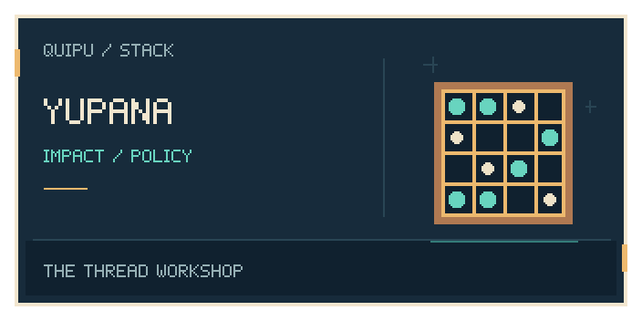

<p align="center"></p>

# yupana

**Yupana reads a codebase and answers structural questions about it: what calls
this function, what would changing it break, and where does this value flow.**
It is for people and AI coding agents (Claude Code, Codex, Cursor) who are about
to edit code they did not write and want the blast radius first. It runs as a
command-line tool, as an MCP server an agent can call, and as editor hooks that
warn at the moment of an edit. The MCP server exposes fifteen `yupana_*` tools.

A [yupana](https://en.wikipedia.org/wiki/Yupana) is the Andean counting board
that worked alongside the quipu: the quipu recorded, the yupana computed.

## Why you would want it

- **Check the blast radius before editing:** follow direct callers and transitive impact.
- **Find a value's route through code:** inspect structural data flow with its analysis tier.
- **Give your agent the same checks:** query through MCP or use edit-time hooks.

[Why Yupana](https://intigraph.github.io/yupana/concepts/why-yupana.html)
explains the use cases and analysis limits.

## Install

```sh
curl -fsSL https://raw.githubusercontent.com/scbrown/yupana/main/install.sh | sh
```

Python 3.9+, curl, and a Linux or macOS shell. Downloads the latest published archive, verifies SHA-256 and the executable
version before publishing command links in `~/.local/bin`. Add it to `PATH`.
The complete versioned bundle stays in `~/.local/lib/yupana/TAG` for rollback.
Published targets: Linux x86_64 and macOS arm64/x86_64; Linux arm64 has no archive.

Set `STACK_INSTALL_ROOT` on the receiving shell for another prefix.
Pinned releases, alternatives, configuration and removal are in the
[installation and usage reference](docs/installation-reference.md).

## First success in three commands



The recording uses a tiny public fixture. [Read the transcript](docs/demos/terminal/transcript.txt)
or [reproduce the recording](docs/demos/terminal.md).

Make a tiny crate where `run` calls `load` and `load` calls `parse`:

```bash
mkdir -p demo/src && cd demo
printf 'pub fn parse(input: &str) -> usize {\n    input.trim().len()\n}\n\npub fn load(path: &str) -> usize {\n    parse(path) + 1\n}\n\npub fn run() -> usize {\n    load("config.toml")\n}\n' > src/lib.rs
```

Then build the graph, ask who calls `parse`, and ask what changing it would
break:

```bash
yupana analyze src
yupana callers parse src
yupana impact parse src
```

```text
analyzed 1 file(s), 3 symbol(s) [tree-sitter]
callers of parse:
  lib.rs:5 load
callees of parse: (none)
impact 2 symbol(s) affected by changing parse:
  lib.rs:5 load (hop 1)
  lib.rs:9 run (hop 2)
```

`run` never calls `parse` directly, yet changing `parse` can still break it.
That second hop is what a text search for `parse(` does not show you.

## On your own code

Replace `src` with your source directory:

| You want to know | Run |
|---|---|
| What structure can be extracted? | `yupana analyze src` |
| Who directly calls a function? | `yupana callers parse src` |
| What is affected one hop away? | `yupana impact parse src --hops 1` |

[CLI reference](https://intigraph.github.io/yupana/reference/cli.html)
covers the remaining commands and options.

## Wire it into your agent

Register the stdio MCP server using its absolute executable path:

```bash
claude mcp add yupana -- "$(command -v yupana)" serve
```

Run `yupana prime` (`--brief`, `--json`, `--static`, or `--section core`) for
orientation and bounded read-only configuration/cache state. It does not refresh
projections or write a spool. See the
[agent primer](https://intigraph.github.io/yupana/getting-started/agent-primer.html)
and [harness integration](https://intigraph.github.io/yupana/getting-started/harness-integration.html).

## Before you start

The release installer needs Python 3.9+, curl and a Linux or macOS shell.
Release archives cover Linux x86_64 and macOS arm64/x86_64; Linux arm64 needs
a source build. Put the installed executable directory on `PATH`. Analysis
coverage depends on the enabled language and extraction tier; inspect the
reported tier before treating an approximation as a precise result.

## What's next

- [The Yupana book](https://intigraph.github.io/yupana/): concepts and reference.
- [Docs map](https://intigraph.github.io/yupana/docs-map.html): find every guide.
- [Quick start](https://intigraph.github.io/yupana/getting-started/quick-start.html): a worked example.

### Related tools and repository knowledge

- [Tambo](https://github.com/scbrown/tambo): guided stack installation and verification.
- [Camayoc](https://github.com/scbrown/camayoc): governed memory and vocabulary.
- [Detailed examples and agent setup](docs/installation-reference.md).

**Load this repository’s graph:** public repository-pendant assets have not yet been verified. When a release supplies the archive, checksum and provenance, follow the [verified import workflow](https://scbrown.github.io/quipu/sharing/index.html): extract the share directory and use `quipu import SHARE_DIR --db repository.db`. Import stages knowledge; ROOT stays unchanged.

## 🧺 The stack

<!-- stack-table:start -->

The Quipu stack is built around a governed, bitemporal knowledge store: shared
facts, decisions and work history your agents can query. Quipu can check writes
against your rules, records where each fact came from, and answers what was true
when.

| tool | what it gives your agents |
|---|---|
| [tambo](https://github.com/intigraph/tambo) | 🧰 Agent Platform Toolkit - installs and configures the quipu stack |
| [quipu](https://github.com/scbrown/quipu) | stores shared facts with provenance and history; can check writes against your rules |
| [camayoc](https://github.com/scbrown/camayoc) | prepares knowledge and vocabulary for Quipu, with checks before it is admitted |
| [quechua](https://github.com/scbrown/quechua) | shared vocabulary and shapes for interoperable knowledge |
| [chaski](https://github.com/scbrown/chaski) | reacts to graph changes and delivers governed notifications |
| [bobbin](https://github.com/scbrown/bobbin) | indexes your codebase and injects context from that index and Quipu knowledge |
| [yupana](https://github.com/scbrown/yupana) | shows code impact and can read policies from Quipu to govern agent actions |
| [desire-path](https://github.com/scbrown/desire-path) | turns agent mistakes into feature requests; works on its own without Quipu |
| [seeds](https://github.com/scbrown/seeds) | a work item tracker backed by the Quipu knowledge base |
| [shantytown](https://github.com/scbrown/shantytown) | runs crews of AI agents on work items, triggered by hand, on a schedule or by events; can share work and memory through Quipu |
| [rikuy](https://github.com/scbrown/rikuy) | live brief: status, graphs, watches and signed decisions over Quipu |
| [shuttle](https://github.com/scbrown/shuttle) | runs signed agent workflows and keeps their records in Quipu |

<!-- stack-table:end -->

## Contributing

Run `just build`, `just test` and `just check` before submitting a change.
See the [contributor guide](https://intigraph.github.io/yupana/reference/contributing.html).

## 📜 License

[Apache-2.0](LICENSE).
